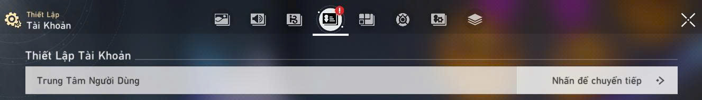
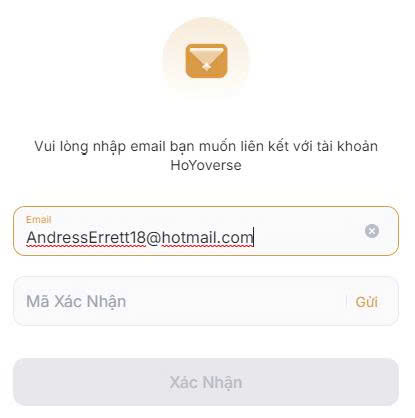
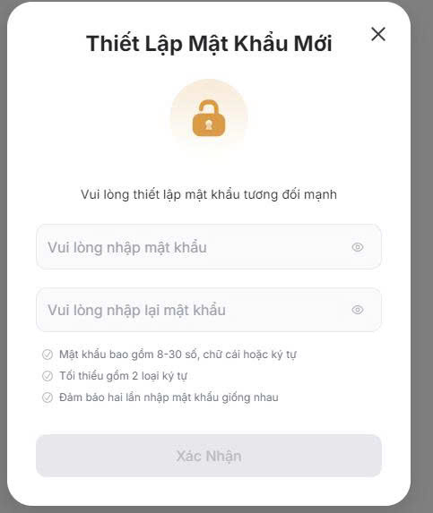

# Cách liên kết tài khoản hoyoverse

> **Ngày đăng**: 26/08/2026 00:53  
> **Mô tả**: chuyển đổi tài khoản Facebook, Google , các liên kết thứ 3 khác qua tài khoản Hoyoverse

## Nội Dung

## bước 1 : các bạn mở game sau đó đến phần cài đặt chọn phần trung tâm người dùng

sau đó  mở lên sẽ hiện thông tin như dưới này

## bước 2 : nếu ở phần thông tin cá nhân chỗ email liên kết đã hiện email là đã có tài khoản hoyoverse và tài khoản hoyovese chính là email đó . Còn nếu không có mail ở phần  thông tin cá nhân là tài khoản chưa được liên kết Hoyoverse, bạn có thể liên kết bằng cách nhập email của bạn vào rồi ấn nhận mã như ảnh dưới

## bước 3 : Bạn chọn phần mật khẩu và an toàn . Sau đó bấm nhận mã để đổi mật khẩu mới  mã sẽ về email mà bạn vừa liên kết

sau đó các bạn thiết lập mật khẩu mới là được

## ====> như vậy tài khoản hoyoverse sẽ là email bạn liên kết ở bước 2 và mật khẩu bạn mới đổi các bạn nhé
