# Dữ Liệu Toàn Bộ Bài Viết Blogs

*Tổng hợp vào lúc: 09:45:15 12/10/2026*
*Tổng số bài viết: 5*

---

## 2. Cách gỡ liên kết thứ 3

- **Slug**: `golienketthu3`
- **Ngày đăng**: 26/08/2026 01:21
- **Tóm tắt**: Gỡ các liên kết thứ 3 như facebook , Google , X , apple để bán acc
- **Thumbnail**: 

### Nội dung chi tiết:

# bước 1 : các bạn mở game đăng nhập đúng nick  sau đó đến phần cài đặt chọn phần trung tâm người dùng

sau đó mở lên sẽ hiện thông tin như dưới này

# bước 2 : Kiểm tra phần " liên kết tài khoản "

như ảnh ví dụ trên đây  đây acc này bên shop có dính 1 liên kết đó là Facebook Nồng nọc

# Bước 3 : quan trọng nhất cần đọc thật kĩ

ấn vô kí hiệu gỡ bên góc phải liên kết như ảnh

sau đó ấn ok nó sẽ hiện ra 1 đường link đăng nhập tài khoản Facebook hoặc chọn Facebook có sẵn ở  máy . Để có thể gỡ được các bạn phải đăng nhập hoặc chọn đúng cái facebook ở trong ảnh , ví dụ shop muốn gỡ cái liên kết nòng nọc thì shop phải đăng nhập cái tài khoản mật khẩu của Facebook Nòng nọc mới gỡ được

Sau khi nhập xong đúng tài khoản đã liên kết thì sẽ gỡ khỏi tài khoản nhé

như này là đã thành công

# Lưu Ý

# - đối với liên kết Google bắt buộc các bạn phải gỡ trên máy android

# - đối với liên kết Apple , Game Center các bạn buộc phải gỡ trên hệ điều hành IOS

# - Steam gỡ sau 30 ngày 1 lần

# - PSN tự gỡ được 1 lần những lần sau phải gửi thư cho nhà phát hành gỡ dùm

# - FB vs X có thể gỡ được ở mọi thiết bị chỉ cần có đúng tài khoản

---

## 3. Cách liên kết tài khoản hoyoverse

- **Slug**: `cachlienkethoyoverse`
- **Ngày đăng**: 26/08/2026 00:53
- **Tóm tắt**: chuyển đổi tài khoản Facebook, Google , các liên kết thứ 3 khác qua tài khoản Hoyoverse
- **Thumbnail**: 

### Nội dung chi tiết:

## bước 1 : các bạn mở game sau đó đến phần cài đặt chọn phần trung tâm người dùng

sau đó  mở lên sẽ hiện thông tin như dưới này

## bước 2 : nếu ở phần thông tin cá nhân chỗ email liên kết đã hiện email là đã có tài khoản hoyoverse và tài khoản hoyovese chính là email đó . Còn nếu không có mail ở phần  thông tin cá nhân là tài khoản chưa được liên kết Hoyoverse, bạn có thể liên kết bằng cách nhập email của bạn vào rồi ấn nhận mã như ảnh dưới

## bước 3 : Bạn chọn phần mật khẩu và an toàn . Sau đó bấm nhận mã để đổi mật khẩu mới  mã sẽ về email mà bạn vừa liên kết

sau đó các bạn thiết lập mật khẩu mới là được

## ====> như vậy tài khoản hoyoverse sẽ là email bạn liên kết ở bước 2 và mật khẩu bạn mới đổi các bạn nhé

---

## 4. Chính sách trả góp

- **Slug**: `chinhsachtragop`
- **Ngày đăng**: 25/08/2026 18:49
- **Tóm tắt**: chính sách trả góp không tốn thêm bất kì chi phí nào
- **Thumbnail**: 

### Nội dung chi tiết:

# 📜 CHÍNH SÁCH TRẢ GÓP ACC – KỲ HẠN 14 NGÀY

### 💰 1. Thanh toán ban đầu
- Khách hàng thanh toán trước **50% tổng giá trị ACC** để bắt đầu giao dịch.
- Sau khi thanh toán đủ 50%, khách được đăng nhập và sử dụng ACC theo thỏa thuận.

### ⏰ 2. Thời hạn trả góp
- Thời gian hoàn tất thanh toán: **14 ngày** kể từ ngày bắt đầu giao dịch.
- Trong thời hạn này, khách có trách nhiệm thanh toán đầy đủ **50% số tiền còn lại**.

### ⚠️ 3. Chính sách thanh toán trễ
- Khách được phép thanh toán trễ **tối đa 02 ngày** so với hạn quy định.
- Nếu thanh toán trễ, khách sẽ chịu phí trễ hạn bằng **10% tổng giá trị ACC**.
- Nếu quá 02 ngày kể từ hạn thanh toán mà khách không thanh toán hoặc không phản hồi, Shop có quyền **thu hồi lại ACC**.

### 🚫 4. Không hủy giao dịch
- Sau khi đã thanh toán khoản trả trước và nhận ACC, khách **không được tự ý hủy kèo**.
- Nếu khách chủ động hủy giao dịch hoặc không tiếp tục thanh toán, **số tiền đã thanh toán sẽ không được hoàn lại**, trừ trường hợp có thỏa thuận khác hoặc lỗi thuộc trách nhiệm bên bán.

### 🔄 5. Không đổi ACC trong thời gian trả góp
- Trong thời gian ACC chưa được thanh toán đủ 100%, khách **không được đổi sang ACC khác**.
- Trường hợp ACC phát sinh lỗi thuộc trách nhiệm bên bán sẽ được xử lý theo chính sách bảo hành riêng.

### ✅ 6. Hoàn tất giao dịch
- Sau khi khách thanh toán đủ 100% giá trị ACC và phí phát sinh nếu có, giao dịch trả góp được xác nhận **hoàn tất**.

---

### 📌 TÓM TẮT QUY TRÌNH
> **Trả trước 50%** ➔ **Nhận ACC** ➔ **Thanh toán phần còn lại trong 14 ngày**  
> - **Trễ hạn**: Tối đa 2 ngày, phí trễ = 10% tổng giá trị ACC.  
> - **Quá 2 ngày** không thanh toán / không phản hồi: **Thu hồi ACC**.  
> - **Quy định**: Trong thời gian trả góp **không hủy kèo – không đổi ACC – khách tự hủy không hoàn tiền**.

Zenless Zone Zero  và Wuthering Waves chỉ hỗ trợ trả góp tối đa 1 tháng.

# 📌Điều kiện áp dụng

Chỉ áp dụng trả góp cho tài khoản có giá trị từ 500.000đ trở lên ( Tùy tài khoản sẽ có những acc shop không hỗ trợ trả góp do muốn bán trực tiếp  )

# 💵Phí trả góp :

Thời gian trả góp từ 2 tháng trở xuống: không phát sinh thêm phí. Đối với những tài khoản có giá trị cao và khách hàng muốn trả góp lâu hơn, vui lòng Inbox shop để thương lượng và được hỗ trợ riêng.

# ❌Hủy giao dịch:

Nếu khách hàng hủy giao dịch trong thời gian trả góp, shop sẽ giữ lại 50% số tiền khách hàng đã thanh toán/cọc. Số tiền còn lại sẽ được hoàn trả lại cho khách hàng

# 🔐 Quy định đăng nhập

- Trong thời gian trả góp, shop chỉ cấp mã đăng nhập 1 lần duy nhất.

Khách hàng vui lòng lấy mã đăng nhập cho tất cả thiết bị muốn sử dụng ngay trong lần đầu tiên. Sau khi đã cấp mã lần đầu, shop không hỗ trợ cấp lại mã đăng nhập trong thời gian trả góp.

- Đổi với những acc có roll khách hàng vui lòng không được sử dụng khi chưa thanh toàn 100% tài khoản tránh phá tài nguyên acc

## ⚠️ QUAN TRỌNG

MONG KHÁCH HÀNG ĐỌC KỸ TOÀN BỘ CHÍNH SÁCH VÀ CÁC MỐC THỜI GIAN GÓP CỦA ACC  TRƯỚC KHI ĐĂNG KÝ TRẢ GÓP TRÁNH BÊN SHOP THU HỒI ACC

Khi khách hàng đã tham gia trả góp, điều đó đồng nghĩa với việc đã đọc và đồng ý với các điều khoản trên.

# ❗ SAI ĐIỀU KHOẢN → SHOP SẼ KHÔNG HỖ TRỢ.

💬 Mọi thắc mắc vui lòng liên hệ CSKH để được giải đáp trước khi tiến hành trả góp.****

---

## 5. Hướng dẫn sử dụng mail Outlook

- **Slug**: `huongdansudungmailoutlook`
- **Ngày đăng**: 25/08/2026 16:47
- **Tóm tắt**: Hướng dẫn đổi pass , thêm bảo mật cho mail outlook
- **Thumbnail**: 

### Nội dung chi tiết:

# -  Trường hợp một : Thêm bảo mật

Khi bạn mua xong bên shop cung cấp tài khoản mật khẩu mail cho bạn , nếu bạn đăng nhập  gặp trường hợp này

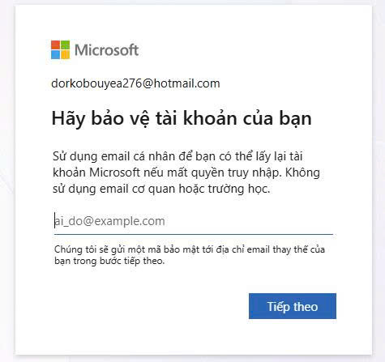

bạn chỉ việc điền mail cá nhân của bạn vô rồi ấn tiếp theo , sau đó mã về mail của bạn bạn chỉ việc nhập mã đó vô là gmail cá nhân của bạn sẽ thành lớp bảo mật thứ 2 cho mail outlook.

# - Cách đổi pass mail outlook trên máy tính ( PC )

+ bước 1  các bạn truy cập link https://outlook.live.com/mail/  đăng nhập tài khoản và mật khẩu 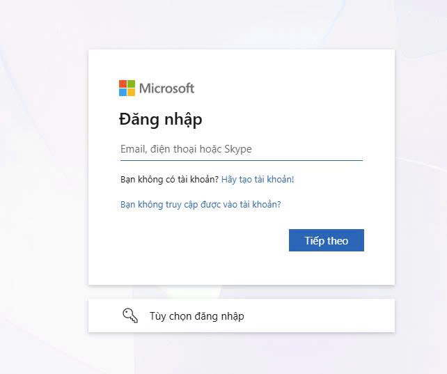

sau đó ở góc phải trên cùng màn hình máy tính các bạn ấn vào phần My microsoft account

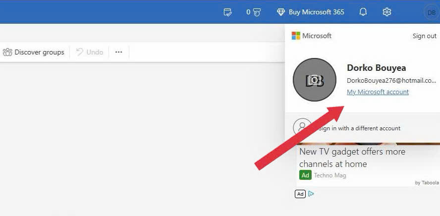

sau đó chọn security

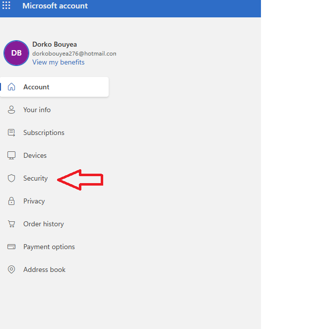

tiếp theo chọn Manage how I sign in

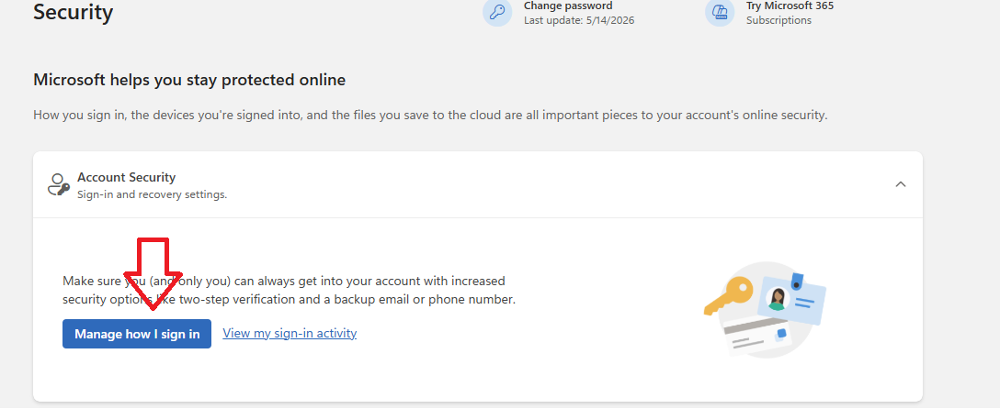

sau đó bạn chọn gửi mã đến mail khôi phục rồi sau đó  điền mail mà bạn đã thêm bảo mật ở trường hợp 1 shop đã hướng dẫn ở trên phần thêm bảo mật ở trường hợp 1

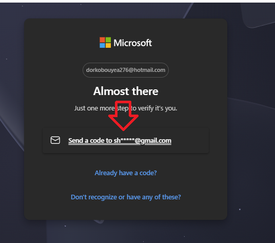

sau khi lấy mã xong sẽ hiện tất cả bảo mật mail 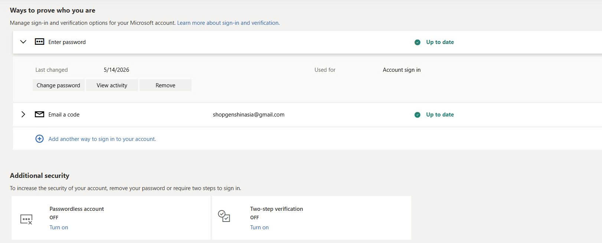

- chọn change password để đổi mật khẩu mail

- chọn add another way to sign in to your account. để thêm hoặc xóa mail khôi phục bảo mật 2 lớp ở mail

- chọn sign out every where để đăng xuất mail khỏi thiết bị trong vòng 24h

Như vậy là chúng ta đổi xong mật khẩu và bảo mật cho mail outlook rồi các bạn nhé Lưu ý tuyệt đối : không được đổi tên đăng nhập của mail kẻo không thể nhận mã từ game nữa

# - Cách đổi pass mail outlook trên điện thoại

bước 1 : các bạn dùng trình duyệt ở điện thoại truy cập  https://outlook.live.com/mail/ sau đó chọn bạn không truy cập được vào tài khoản

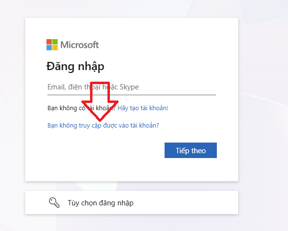

sau đó chọn tài khoản cá dân ( do bạn tạo ) rồi nhập tên mail outlook  của bạn vô 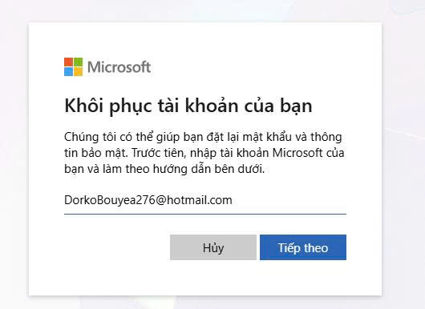

sau đó ấn tiếp theo nó sẽ hiện ra các phương án để lấy lại mật khẩu mail . bạn chọn gửi email đến mail bảo mật mà bạn đã thêm ở trường hợp 1

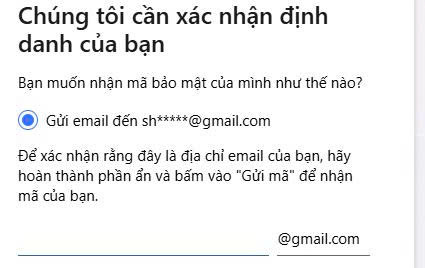

sau đó nhập mã là bạn đã hoàn thành đổi pass cho mail outlook rồi nhé 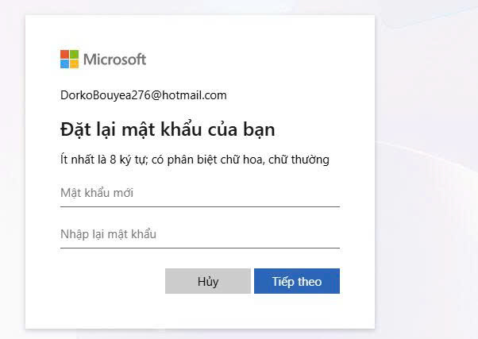

---

## 6. Chính sách bảo hành game hoyoverse

- **Slug**: `chinhsachbaohanh`
- **Ngày đăng**: 25/08/2026 16:00
- **Tóm tắt**: chính sách bảo hành tài khoản sau khi tài khoản
- **Thumbnail**: 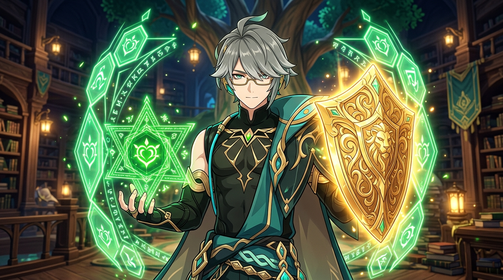

### Nội dung chi tiết:

**Đối với các tài khoản game nhà Hoyoverse**

Shop cung cấp **2 lựa chọn bảo hành** để khách hàng chủ động lựa chọn theo nhu cầu sử dụng và mức độ bảo mật mong muốn.

**## 🔹 LỰA CHỌN 1: CÓ BẢO HÀNH**

- Khách hàng đăng nhập tài khoản bằng **mã đăng nhập do shop cung cấp**.

- Mã đăng nhập chỉ cần xác nhận **1 lần trên mỗi thiết bị**. Hệ thống sẽ ghi nhớ thiết bị đã đăng nhập.

- Khi khách hàng chuyển sang **thiết bị mới**, có thể cần lấy lại mã đăng nhập thì hãy ibox bên shop sẽ cấp mã ngay

- Trong thời gian bảo hành, nếu acc có bất kì vấn đề nào liên quan đến bảo mật bên shop sẽ hoàn lại 100% số tiền quý khách đã mua tài khoản hoặc lựa 1 acc khác cùng hoặc cao hơn mức giá bạn đã mua một chút

- shop khuyên khích khách hàng nên sử dụng lựa chọn này chơi 1 vài tháng để kiểm tra tính ổn định của tài khoản

**## 🔹 LỰA CHỌN 2: KHÔNG BẢO HÀNH**

- Shop hỗ trợ và cung cấp mã từ mail liên kết để khách hàng **đổi sang email cá nhân**.

- Nếu game không hỗ trợ đổi email, shop sẽ **bàn giao email đang liên kết với tài khoản** cho khách hàng nếu tài khoản có thể giao mail được .

- Sau khi khách hàng tự quản lý toàn bộ thông tin bảo mật,  bên shop sẽ không còn bảo hành tài khoản nữa

**### 📌 NGOẠI LỆ ĐỐI VỚI LỰA CHỌN 2**

- đối tới các tài khoản chưa có username ( tên đăng nhập ) thì khách hàng vui lòng set username ( tên đăng nhập )

- Khi tài khoản xảy ra vấn đề , khách hàng nhập username vào phần quên mật khẩu hiện như ảnh thì bên shop sẽ hoàn tiền ngay lập tức

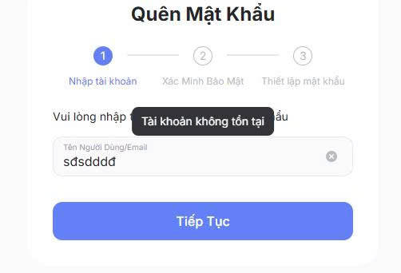

**Điều kiện:** UID của tài khoản vẫn phải còn tồn tại trên hệ thống game để tránh khách sử dụng chức năng xóa tài khoản để đòi tiền bảo hành

**## ⚠️ LƯU Ý QUAN TRỌNG**

- Khách hàng vui lòng **đọc kỹ chính sách bảo hành trước khi đăng nhập và sử dụng tài khoản** để đảm bảo quyền lợi của mình.

- Shop khuyến khích khách hàng **giữ email shop trong một khoảng thời gian** trước khi chuyển sang email cá nhân nhằm đảm bảo an toàn tài khoản.

- Một số tài khoản đặc biệt hiện **chưa thể bàn giao email hoặc chưa thể đổi email**  do chính sách bảo mật của game  . Đối với những trường hợp này, shop sẽ ** cấp mã đăng nhập và bảo hành cho khách hàng cho đến khi tài khoản có thể đổi email ** . Nếu khách hàng không đồng ý với tình trạng trên, khách hàng có thể  **yêu cầu hoàn tiền trước khi đăng nhập và sử dụng tài khoản* . Shop không hỗ trợ hoàn tiền đối với tài khoản mà khách hàng đã đăng nhập**

❤️ CAM KẾT TỪ SHOP

- Shop luôn ưu tiên **an toàn tài khoản, quyền lợi khách hàng và hỗ trợ minh bạch**. Vui lòng lựa chọn hình thức bảo hành phù hợp trước khi nhận tài khoản.

- Bên shop nói không với acc SCAM hay ACC BẨN . Nếu phát hiện UID có vấn đề hãy Ibox bên mình sẽ hoàn tiền lại ngay cho khách hàng

---

